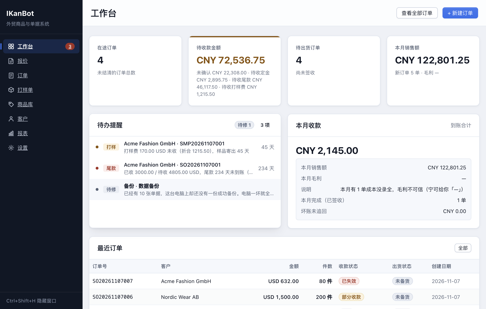
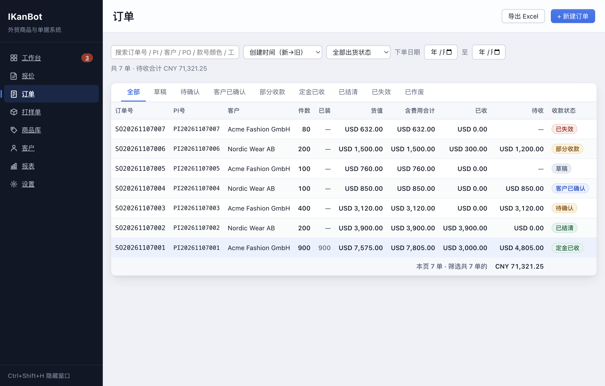
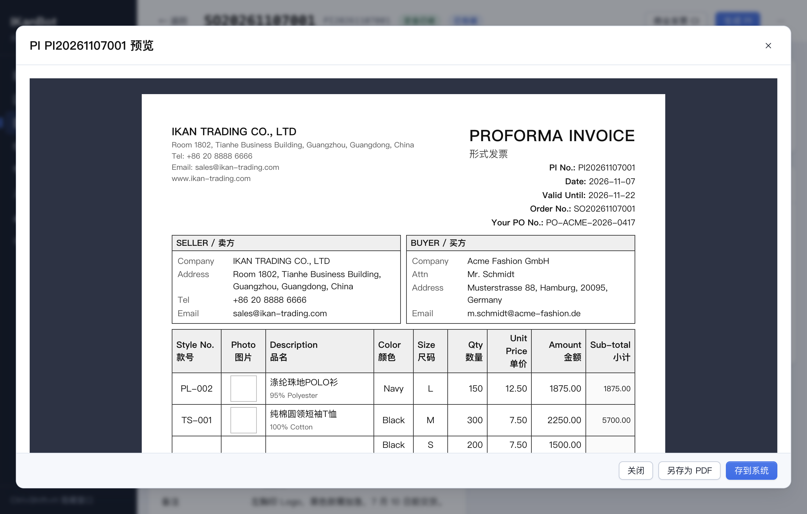
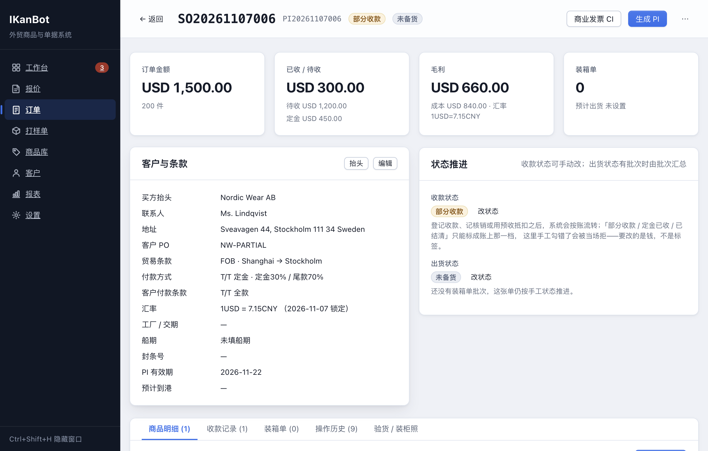
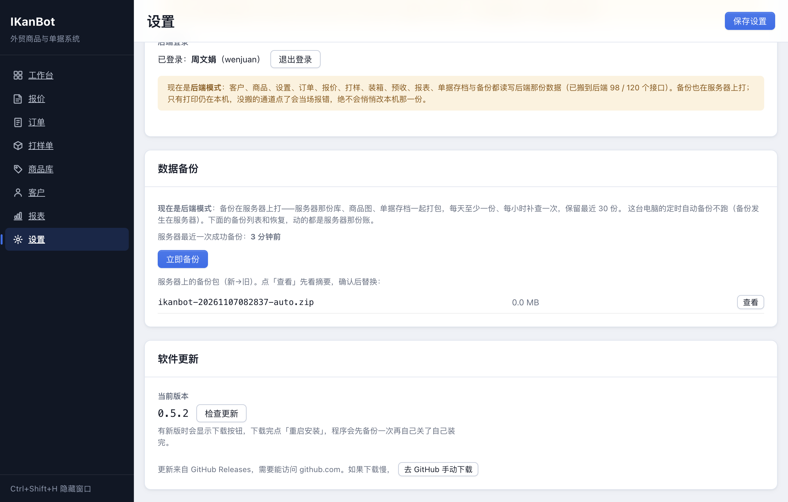

# IKanBot — 外贸商品录入与单据生成系统

面向服装类外贸的本地桌面工具：录入商品 → 建订单 → 生成 PI（形式发票）/ PL（装箱单）→ 跟踪收款与出货。

数据全部保存在本机 SQLite 单文件，不依赖网络。

---

## 快速开始

```bash
npm install
npm run dev          # 开发模式（热重载）
npm run build        # 构建到 out/
npm run pack         # 打包为免安装目录 release/win-unpacked
npm run dist         # 打包为安装包 + 免安装 exe
npm run test:e2e     # 端到端业务逻辑测试（2549 项断言）
npm run typecheck    # TypeScript 类型检查
```

打包产物在 `release/`：
- `IKanBot-<版本>-x64.exe` — NSIS 安装包（可选安装目录、创建快捷方式）
- `IKanBot-<版本>-portable.exe` — 免安装单文件版
- `IKanBot-<版本>-x64.dmg` / `-arm64.dmg` — macOS 安装镜像（Intel / Apple Silicon）
- `IKanBot-<版本>-x64.zip` / `-arm64.zip` — macOS 压缩包（自动更新用）
- `IKanBot-<版本>-x64.AppImage` — Linux 免安装单文件（自带应用内更新）
- `IKanBot-<版本>-x64.deb` — Debian / Ubuntu 安装包
- `IKanBot-<版本>-x64.rpm` — Fedora / RHEL / openSUSE 安装包

macOS 产物未做代码签名，首次打开需右键 →「打开」。AppImage 在较老的发行版上运行需要 `libfuse2`。GitHub Actions 会在推送 `v*` 标签时同时构建 Windows、macOS 与 Linux。

---

## 目录结构

```
electron/                主进程
  db/
    schema.ts            建表 SQL 与迁移（user_version 版本管理）
    index.ts             连接、迁移、编号生成
    mappers.ts           行 → 领域对象
  services/
    products.ts          商品库
    customers.ts         客户与客户统计
    orders.ts            订单、SKU 行、收款、状态自动流转、事件日志
    packing.ts           装箱单
    dashboard.ts         首页统计、待办提醒、月度报表、CSV 导出
    settings.ts          公司信息、银行账户、业务默认值
    backup.ts            备份（自动/手动）
    zip.ts               零依赖 ZIP 写入器
  ipc/index.ts           IPC 通道注册
  preload/index.ts       渲染进程 API 桥
  main/index.ts          窗口、托盘、快捷键

src/
  shared/                主进程与渲染进程共用
    types.ts             数据契约与状态定义
    api.ts               window.api 接口定义
    documents.ts         PI / PL 单据 HTML 生成
  renderer/src/          界面
    pages/               Dashboard / Orders / OrderDetail / Products / Customers / Reports / Settings

scripts/
  e2e-test.ts            端到端业务测试
  seed.ts                演示数据
  after-pack.cjs         打包后写入图标
```

---

## 核心概念

### 商品
款号（唯一）+ 品名 + 成分 + 成本价 + **自有尺码表** + **自有颜色表** + 图片。

尺码与颜色不预设体系，由每个款号自带（S/M/L、38/39/40、XXL… 随意）。下单时按
`款号 × 颜色 × 尺码` 生成 SKU 矩阵，填 0 即不出货。

- 复制款号建新款（同款换色换价最快的路径）
- 一款可挂 1~3 张图，第一张自动成为主图（PI 会显示主图）

### 客户
公司 / 联系人 / 收件人 / 国家 / 地址 / 邮编 / 付款偏好 / 备注。

客户详情页汇总：订单数、累计成交额、累计毛利、**未收金额**（金额按订单汇率折算为基准币）。

### 订单
一单可含多个款号，每款可多颜色尺码（每行 = 一个 SKU）。

字段：客户、币种、汇率、贸易术语、装运港、目的港、付款方式、定金比例、PI 有效期、
预计出货/到港日、客户 PO 号、备注。

编号规则：`PI20260320001` / `PL20260320001` / `SO20260320001`（年月日 + 三位序号）。

### 两条独立的状态线

**收款状态**（自动流转）
```
草稿 → 已发送 → 客户已确认 → 部分收款 → 已收款 → 已结清
                                    ↘ 已失效
```
收到定金自动跳「部分收款」，定金收齐自动跳「已收款」，全额收齐跳「已结清」。
`草稿 / 已发送 / 已失效` 不参与自动流转（避免误改）。

**出货状态**（手动推进，与收款互不影响）
```
未备货 → 备货中 → 已包装 → 已出运 → 已清关 → 已签收
```

### 收款
每次收款记一笔流水：日期、金额、方式、**银行流水号**、备注。
PI 上自动体现定金比例与尾款；客户详情页显示未收金额。

双击或失败重试不会落两笔：每个落钱入口（订单收款 / 打样费收款 / 预收退款 / 一笔水单拆到多单）
带幂等键，成功才换号，同键重放直接拿回第一次的结果。

### 两人同时改一条账
编辑保存时带上「读那一刻」的行版本号（row_version）：这段时间里别人改过，保存会被拦下
——「这条记录刚被别人改过，请刷新后再试」，不会拿旧画面悄悄盖掉新账（覆盖订单、商品、
客户、报价、打样五张热表）。编辑弹窗 / 详情页开着时每 30 秒静默盯一轮，别人刚改过会出一条
**不拦操作的黄条弱提示**，重新载入（或关掉重开）即消。出货状态回写、收款这类不碰表单字段的
连带写也一样算「改过」，不会有漏网的。

### 装箱单
一单可出多张 PL（分批出货）。按 SKU 自动汇总 → 填每箱件数自动拆箱 → 手工调整。

- 毛重未填时按 `净重 × 系数`（默认 1.1）估算，每箱可手填覆盖
- 体积（CBM）按箱规计算：`(长×宽×高) / 1000000`，**每箱算一次**，不乘件数

---

## 单据

A4 纵向，**中英双语**，HTML + CSS 渲染后经 Electron `printToPDF` 输出。

**PI（形式发票）**
抬头公司信息 + Logo、客户信息、PI 号/日期/有效期/客户 PO 号、
商品表（款号 / 主图 / 品名 / 成分 / 颜色 / 尺码 / 数量 / 单价 / 金额 / 款号小计）、
合计、付款方式与定金、贸易条款与汇率、收款银行信息、备注、签字区。

**PL（装箱单）**
发货人与收货人、箱号 / 款号 / 品名 / 颜色 / 尺码 / 数量 / 净重 / 毛重 / 箱规 / CBM，
总箱数、总数量、总净重、总毛重、总体积、柜号、签字区。不带图片。

预览 → 确认 → 保存 PDF 或直接打印。

---

## 待办提醒

| 提醒 | 触发条件 | 默认阈值 |
|---|---|---|
| 催确认 | PI 已发出后未确认 | 7 天 |
| 催款 | 客户已确认后未收款 | 10 天 |
| 催备货 | 距预计出货日临近仍未包装 | 提前 3 天 |

阈值可在设置页调整。首页汇总所有待办，点击直达订单。

---

## 数据与备份

```
data/
  ikanbot.db      SQLite 主库
  images/         商品图片与 Logo
  backups/        备份 zip（保留最近 30 份）
```

- 程序启动时每天自动备份一次
- 设置页可手动备份、打开备份目录、**导出整库（搬迁用）**（四步见 `docs/migration.md`）
- 恢复完成后设置页亮出**搬迁对账**：核心表逐表行数、收款合计、单号唯一性、客户预收余额——跟恢复前心里记的数对不上，就别接着录单
- 备份为 zip，含 `ikanbot.db` 与 `images/`
- 打包版数据位于 `%APPDATA%/IKanBot/data/`

---

## 币种与汇率

订单级币种（USD / CNY / EUR / GBP / HKD）+ 手工汇率（1 外币 = X 基准币）。
**不做实时汇率**——锁汇是人工决策。

首页、报表、客户统计统一折算为基准币显示；订单与 PI 保留原币金额。
导出的 Excel 同时含原币列与基准币列。

---

## 导出

- 订单台账 CSV（UTF-8 BOM，Excel 直接打开）
- 收款台账 CSV

---

## 界面与测试对照

按 AGENTS.md 立项目规则：**界面更新必须带截图矩阵入库（docs/ui/），并与实现同一提交**。
每张截图对应「页面 × 交互状态」，逐张标注它背后的行为被 `scripts/e2e-test.ts` 哪个
section 的断言锁着；纯数据层断言、界面上没有独立形态的（CSV 导出、备份、编号查重等）
注「无 UI 形态」。

几张代表形态先看为快（全量矩阵走下面的链接；相对路径，GitHub 首页直接可见）：


工作台全貌：待办提醒、本月成交与待收一眼看完，金额都按订单汇率折成基准币。


订单列表：收款状态、出货状态两排标签同屏，哪几张在等钱、哪几张没出货一屏扫完。


PI 单据预览：A4 纵向中英双语，带主图与费用行，浏览器打印即成 PDF。


订单详情毛利卡：货值、成本、汇率钉在单上，成本缺失时这里显示「不可信」而不是拿 0 算。


设置页数据来源卡：本机/后端模式一目了然，备份卡跟着模式换形态（远端时备份在服务器上打）。

- 当前矩阵：[docs/ui/r59/](docs/ui/r59/README.md) —— 9 个页面 × 29 个交互/状态形态 = 38 张实拍，
  收款状态标签 8 种全部露脸
- 增量矩阵：[docs/ui/r60/](docs/ui/r60/README.md) —— Modal portal 化（弹窗居中修复）+ 作废/失效单隐藏出单据按钮 + 单据存档上后端（设置页覆盖数），9 张实拍对照
- 增量矩阵：[docs/ui/r61/](docs/ui/r61/README.md) —— 备份簇上后端（设置页备份卡分模式、服务器备份列表与恢复确认）+ 401 清假登录态 + 新建订单草稿恢复，4 张实拍对照
- 增量矩阵：[docs/ui/r62/](docs/ui/r62/README.md) —— 编辑已有订单弹窗的草稿暂存（打开即回填 + 恢复提示，按单分键）
  + M4 收款幂等的三个落钱入口（订单收款 / 打样费收款 / 预收退款）实拍，5 张对照
- 增量矩阵：[docs/ui/r63/](docs/ui/r63/README.md) —— M4 第二片「有人正在改」弱提示（订单编辑弹窗 / 订单详情
  + 重新载入即消 / 客户 / 商品 / 报价 / 打样六处实拍），7 张对照
- 增量矩阵：[docs/ui/r68/](docs/ui/r68/README.md) —— 恢复对账卡（设置页：12 表行数 + 收款合计 +
  单号唯一 + 抵扣台账 + 客户预收余额），2 张对照
- 增量矩阵：[docs/ui/r71/](docs/ui/r71/README.md) —— 对账卡的 diff 呈现（包内 vs 恢复后：对平绿行 /
  不平红块差异明细 / 老包无对账明说），3 张对照
- 增量矩阵：[docs/ui/r74/](docs/ui/r74/README.md) —— 备份卡「导出整库（搬迁用）」入口
  （搬迁四步手册 docs/migration.md），1 张对照
- 增量矩阵：[docs/ui/r76/](docs/ui/r76/README.md) —— 客户详情缺汇率单清单（口径对齐工作台
  「汇率待修」，单号可点直达），1 张对照
- 增量矩阵：[docs/ui/r77/](docs/ui/r77/README.md) —— 毛利卡的缺汇率直达链接（不可信的原因
  可点排查），1 张对照
- 增量矩阵：[docs/ui/r78/](docs/ui/r78/README.md) —— 毛利卡的「成本没录全」直达链接
  （与缺汇率清单同构），1 张对照
- 增量矩阵：[docs/ui/r83/](docs/ui/r83/README.md) —— 设置页「数据自检」（活库探针闸的
  用户主动版：quick_check/版本/12 表行数），1 张对照
- 增量矩阵：[docs/ui/r84/](docs/ui/r84/README.md) —— 自检红框人话化：problems 问题清单
  先行 + quick_check 原文技术行（绿框不变；坏库副本实拍），2 张对照
- 增量矩阵：[docs/ui/r85/](docs/ui/r85/README.md) —— 数据自检的远端路实弹：远端模式
  绿框（服务器空库 12 表全 0，本机 4 单同屏对比）+ problems 红框经 HTTP 通道原样渲染，
  2 张对照
- 增量矩阵：[docs/ui/r86/](docs/ui/r86/README.md) —— 备份快照的隐形修复说破：坏库红框
  多一条「立即备份 = 修复路」指引（VACUUM INTO 快照重建，行为锁三条），1 张对照
- 增量矩阵：[docs/ui/r89/](docs/ui/r89/README.md) —— 工作台健康红条：库坏了开屏就拦
  （「先别录单」+ problems 首条 + 跳设置页自检详情；坏副本实拍），2 张对照
- 增量矩阵：[docs/ui/r90/](docs/ui/r90/README.md) —— 健康红条两分支共用：深损坏 stats
  全挂的早退分支也拦（R89 复验挑的洞；数据页坏副本实拍），1 张对照
- 增量矩阵：[docs/ui/r91/](docs/ui/r91/README.md) —— 红条详情锚点直滚：`?scroll=backup`
  进设置页直达数据备份卡（红框详情同屏；全链路落地态实拍），1 张对照
- 增量矩阵：[docs/ui/r92/](docs/ui/r92/README.md) —— 锚点竞态修复：等两张卡的数据到位
  再滚（修复前直进 10 跑 7 落 → 修复后 6 跑全中落点逐像素一致），1 张对照
- 增量矩阵：[docs/ui/r94/](docs/ui/r94/README.md) —— 远端模式健康链路全链实拍：工作台
  红条（服务器坏库 problems 经 HTTP）→ 锚点详情直滚 → 红框详情（R89/R91/R92 远端挂账
  清偿），2 张对照
- 断言规模：e2e 2560 项 · 双模式 146 项 · 数据层 82 项 · HTTP 冒烟 241 项
  （`npm run test:all`；`npm run audit:http` = server 路由功能断言覆盖 108/108、
  `npm run audit:ipc` = IPC 三层接线 132/132 · 远端 100 全对齐）

---

## 技术选型说明

- **Electron + React + TypeScript**：本地 exe、双击即用
- **node-sqlite3-wasm**（纯 WASM）：无需原生编译，跨平台，避免 `better-sqlite3` 在
  Node 24 下无预编译二进制、且本机无 VS 编译工具的问题
- **自写 ZIP 写入器**：备份打包不引入额外依赖
- **单据用 HTML/CSS 而非 pdfkit**：版式所见即所得，调打印排版成本最低

### 打包注意事项

`electron-builder.yml` 中 `win.signAndEditExecutable: false`，
改由 `scripts/after-pack.cjs` 调用 `rcedit-x64.exe` 写入图标与版本信息。
原因是内置流程需解压 `winCodeSign`，该包含 macOS 符号链接，
在未开启「开发者模式」的非管理员环境下会失败。Windows 工具本身解压不受影响。

---

## 明确不做（留待以后）

Excel 导入商品 · 实时汇率 API · 邮件自动发送 · Word/Excel 单据导出 ·
图表库 · 多用户权限 · 供应商/工厂管理 · 库存管理 · 采购单 · 登录
